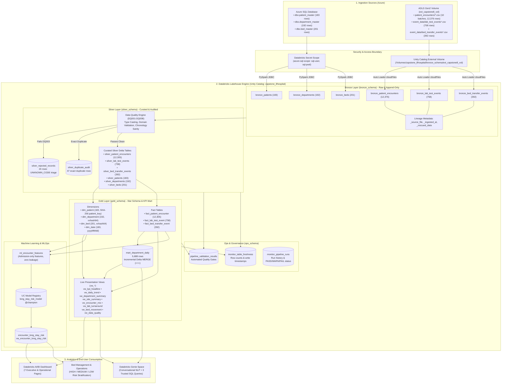
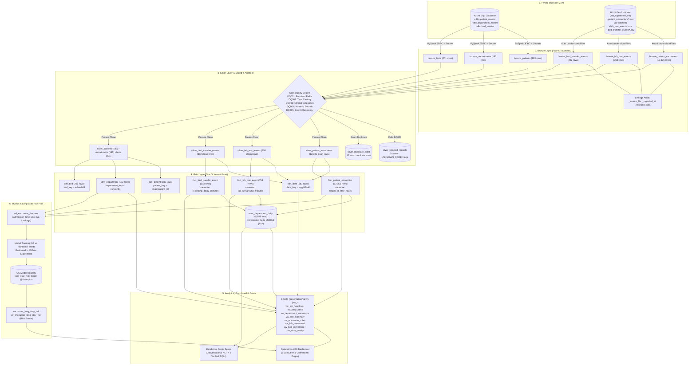
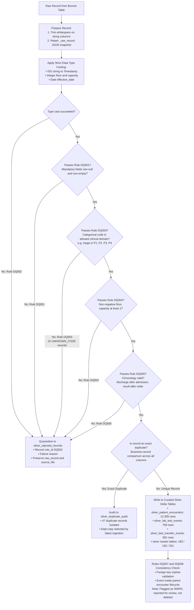
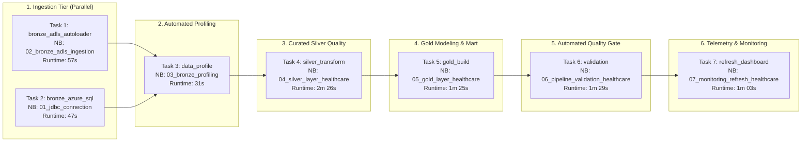

# MediFlow Lakehouse: Architecture & Diagram Master Guide

This directory contains the complete diagram suite, technical architecture specifications, and visual artifacts for the **MediFlow Hospital Operations & Patient Journey Lakehouse Platform**.

---

## Directory Inventory

| File Name                                                                                                                                                                                  | Format           | Description                                                                                        |
| ------------------------------------------------------------------------------------------------------------------------------------------------------------------------------------------ | ---------------- | -------------------------------------------------------------------------------------------------- |
| [`viewer.html`](file:///c:/Users/Arnav/Desktop/Hospital%20Operations%20Capstone%20Project/Project_Architecture_and_Diagrams/viewer.html)                                                   | Interactive HTML | Open in any browser to view all 6 Mermaid diagrams rendered with zoom/pan and export capabilities! |
| [`01_HLD_System_Architecture.mmd`](file:///c:/Users/Arnav/Desktop/Hospital%20Operations%20Capstone%20Project/Project_Architecture_and_Diagrams/01_HLD_System_Architecture.mmd)             | Mermaid          | High-Level Design (HLD) Architecture diagram showing end-to-end data flow                          |
| [`02_LLD_Component_and_ERD.mmd`](file:///c:/Users/Arnav/Desktop/Hospital%20Operations%20Capstone%20Project/Project_Architecture_and_Diagrams/02_LLD_Component_and_ERD.mmd)                 | Mermaid          | Low-Level Design (LLD) Entity-Relationship Diagram (ERD) of the Gold Star Schema                   |
| [`03_Complete_Lakehouse_Flowchart.mmd`](file:///c:/Users/Arnav/Desktop/Hospital%20Operations%20Capstone%20Project/Project_Architecture_and_Diagrams/03_Complete_Lakehouse_Flowchart.mmd)   | Mermaid          | Complete End-to-End Lakehouse Flowchart across all 6 tiers                                         |
| [`04_Silver_Data_Quality_Flowchart.mmd`](file:///c:/Users/Arnav/Desktop/Hospital%20Operations%20Capstone%20Project/Project_Architecture_and_Diagrams/04_Silver_Data_Quality_Flowchart.mmd) | Mermaid          | Step-by-step Silver DQ001–DQ008 validation, quarantine, and deduplication logic                    |
| [`05_Lakeflow_Job_Workflow_DAG.mmd`](file:///c:/Users/Arnav/Desktop/Hospital%20Operations%20Capstone%20Project/Project_Architecture_and_Diagrams/05_Lakeflow_Job_Workflow_DAG.mmd)         | Mermaid          | Databricks Lakeflow Job task DAG (`cap8_PIPE`) with verified execution runtimes                    |
| [`06_MLOps_MLflow_Lifecycle.mmd`](file:///c:/Users/Arnav/Desktop/Hospital%20Operations%20Capstone%20Project/Project_Architecture_and_Diagrams/06_MLOps_MLflow_Lifecycle.mmd)               | Mermaid          | MLflow experiment tracking, model registry, `@champion` alias, and batch scoring                   |
| `Pipeline (1).png`                                                                                                                                                                         | Image            | Live Databricks Job DAG execution screenshot (View 1)                                              |
| `Pipeline (2).png`                                                                                                                                                                         | Image            | Live Databricks Job DAG execution screenshot (View 2)                                              |
| `Pipeline (3).png`                                                                                                                                                                         | Image            | Live Databricks Job DAG execution screenshot (View 3)                                              |
| [`PPT_MASTER_CONTENT_AND_SPEAKER_NOTES.md`](file:///c:/Users/Arnav/Desktop/Hospital%20Operations%20Capstone%20Project/PPT_MASTER_CONTENT_AND_SPEAKER_NOTES.md)                             | Markdown         | Complete study notes, client speaker scripts, and 14-slide PPT presentation text                   |

---

## 1. High-Level Design (HLD) Architecture

---

## 2. Low-Level Design (LLD) - Entity-Relationship Diagram (ERD)

```mermaid
erDiagram
    dim_patient {
        STRING patient_key PK "SHA-256 of patient_id (Pseudonymized)"
        STRING age_band "Age Group (0-17, 18-35, 36-55, 56-75)"
        STRING sex "Patient Biological Sex (F, M, OTHER)"
        STRING city "Residential City"
        STRING insurance_type "Insurance Tier (BASIC, STANDARD, PREMIUM)"
        STRING patient_status "Status (ACTIVE, INACTIVE, PENDING)"
        STRING primary_language "Language (Bengali, English, Hindi, etc.)"
    }

    dim_department {
        LONG department_key PK "xxhash64(department_id)"
        STRING department_id "Business Key (DEP_xxx)"
        STRING department_name "Department Name (Oncology, Cardiology, etc.)"
        STRING specialty "Medical Specialty"
        STRING hospital_site "Facility (Mumbai Central, Bengaluru City, etc.)"
        INT floor "Building Floor (Non-negative)"
        STRING service_level "Service Tier (EMERGENCY, INPATIENT)"
        STRING active_flag "Active Status (Y, N)"
        INT capacity_beds "Planned Bed Capacity (>= 1)"
        STRING region "Geographical Healthcare Region"
    }

    dim_bed {
        LONG bed_key PK "xxhash64(bed_id)"
        STRING bed_id "Business Key (BED_xxx)"
        STRING department_id "Assigned Department ID"
        STRING ward "Ward Classification (GENERAL, ICU, SURGICAL)"
        STRING bed_type "Bed Specification (STANDARD, ICU)"
        STRING isolation_capable "Isolation Flag (Y, N)"
        STRING bed_status "Operational State (ACTIVE, INACTIVE, PENDING)"
        INT floor "Physical Floor"
        STRING hospital_site "Facility Location"
        STRING active_flag "Active Flag (Y, N)"
        DATE effective_date "Commissioning Date"
    }

    dim_date {
        INT date_key PK "Calendar Integer (yyyyMMdd)"
        DATE full_date "Calendar Date (2026-07-01 to 2026-08-30)"
        INT year "Calendar Year (2026)"
        INT month "Month of Year (1-12)"
        INT day "Day of Month (1-31)"
        STRING day_of_week "Weekday Name (Monday, Tuesday, etc.)"
    }

    fact_patient_encounter {
        STRING encounter_key PK "sha2(encounter_id, 256)"
        STRING encounter_id "Business Traceability Key"
        STRING patient_key FK "References dim_patient"
        LONG department_key FK "References dim_department"
        LONG bed_key FK "References dim_bed"
        INT admission_date_key FK "References dim_date (Admission)"
        INT discharge_date_key FK "References dim_date (Discharge)"
        TIMESTAMP admission_ts "Admission Timestamp"
        TIMESTAMP discharge_ts "Discharge Timestamp (NULL if Active)"
        STRING encounter_type "Type (EMERGENCY, INPATIENT, OUTPATIENT)"
        STRING triage_priority "Priority (P1, P2, P3, P4)"
        STRING encounter_status "Status (DISCHARGED, TRANSFERRED)"
        STRING admission_source "Source (EMERGENCY, REFERRAL, WALK_IN)"
        STRING diagnosis_group "Diagnosis Category (CARDIAC, GENERAL, etc.)"
        DOUBLE length_of_stay_hours "Calculated Measure: (discharge - admission)/3600"
    }

    fact_lab_test_event {
        STRING lab_event_key PK "sha2(lab_event_id, 256)"
        STRING lab_event_id "Business Traceability Key"
        STRING encounter_key FK "References fact_patient_encounter"
        STRING patient_key FK "References dim_patient"
        LONG department_key FK "References dim_department"
        INT ordered_date_key FK "References dim_date (Order Date)"
        STRING test_code "Test Type (CBC, GLUCOSE, KFT, LFT)"
        STRING priority "Test Priority (ROUTINE, URGENT, STAT)"
        STRING result_status "Status (ORDERED, COLLECTED, RESULTED)"
        TIMESTAMP ordered_ts "Order Timestamp"
        TIMESTAMP collected_ts "Specimen Collection Timestamp"
        TIMESTAMP result_ts "Result Availability Timestamp"
        DOUBLE lab_turnaround_minutes "Calculated Measure: (result - order)/60"
    }

    fact_bed_transfer_event {
        STRING transfer_key PK "sha2(transfer_id, 256)"
        STRING transfer_id "Business Traceability Key"
        STRING encounter_key FK "References fact_patient_encounter"
        STRING patient_key FK "References dim_patient"
        LONG department_key FK "References dim_department"
        LONG from_bed_key FK "References dim_bed (Origin Bed)"
        LONG to_bed_key FK "References dim_bed (Destination Bed)"
        INT transfer_date_key FK "References dim_date (Transfer Date)"
        TIMESTAMP transfer_ts "Transfer Initiation Timestamp"
        TIMESTAMP recorded_ts "System Logging Timestamp"
        STRING transfer_reason "Reason (CAPACITY, CLINICAL, ISOLATION)"
        STRING transfer_status "Status (ACTIVE, INACTIVE, PENDING)"
        DOUBLE recording_delay_minutes "Calculated Measure: (recorded - transfer)/60"
    }

    mart_department_daily {
        INT date_key PK,FK "References dim_date"
        LONG department_key PK,FK "References dim_department"
        DATE full_date "Calendar Date"
        STRING department_name "Department Name"
        STRING specialty "Medical Specialty"
        STRING hospital_site "Hospital Site"
        LONG encounters_admitted "Daily Admitted Encounters Count"
        DOUBLE avg_length_of_stay_hours "Daily Average Length of Stay (Hours)"
        LONG lab_orders "Daily Lab Orders Placed"
        LONG lab_results "Daily Lab Results Completed"
        DOUBLE avg_lab_turnaround_minutes "Daily Average Lab Turnaround (Minutes)"
        LONG bed_transfers "Daily Bed Transfers Initiated"
        TIMESTAMP updated_ts "Incremental MERGE Timestamp"
    }

    %% Relationships
    dim_patient ||--o{ fact_patient_encounter : "has encounters"
    dim_department ||--o{ fact_patient_encounter : "admits to"
    dim_bed ||--o{ fact_patient_encounter : "assigns"
    dim_date ||--o{ fact_patient_encounter : "admits on"
    dim_date ||--o{ fact_patient_encounter : "discharges on"

    fact_patient_encounter ||--o{ fact_lab_test_event : "orders diagnostic"
    dim_patient ||--o{ fact_lab_test_event : "undergoes"
    dim_department ||--o{ fact_lab_test_event : "orders from"
    dim_date ||--o{ fact_lab_test_event : "ordered on"

    fact_patient_encounter ||--o{ fact_bed_transfer_event : "transfers"
    dim_patient ||--o{ fact_bed_transfer_event : "transferred"
    dim_department ||--o{ fact_bed_transfer_event : "transferred within"
    dim_bed ||--o{ fact_bed_transfer_event : "originates from"
    dim_bed ||--o{ fact_bed_transfer_event : "moves to"
    dim_date ||--o{ fact_bed_transfer_event : "transferred on"

    dim_date ||--o{ mart_department_daily : "aggregates on"
    dim_department ||--o{ mart_department_daily : "summarizes"
```

---

## 3. Complete Lakehouse Flowchart

---

## 4. Silver Layer Data Quality Engine & Quarantine Flowchart

---

## 5. Lakeflow Job Workflow DAG (`cap8_PIPE`)

---

## 6. MLOps & MLflow Long-Stay Risk Lifecycle

```mermaid
flowchart TD
    %% MLOps Lifecycle: Long-Stay Risk Prediction with MLflow & Unity Catalog
    subgraph Data_Prep["1. Feature Engineering & Anti-Leakage"]
        F1["Input Data: fact_patient_encounter, dim_department, dim_patient"]
        F2["Target Definition: label_long_stay = 1 if LOS exceeds 75th percentile<br/>(NULL for open encounters, reserved for scoring)"]
        F3["Admission-Only Features (Zero Data Leakage):<br/>• triage_priority, admission_source, specialty, service_level<br/>• capacity_beds, age_band, sex, insurance_type, admission_hour, is_weekend"]
        F4[("gold_schema.ml_encounter_features")]
        F1 --> F2
        F2 --> F3
        F3 --> F4
    end

    subgraph Experimentation["2. MLflow Experimentation & Tracking"]
        E1["Chronological Split: 70% Train / 30% Test"]
        E2["Scikit-Learn Pipeline:<br/>• Numerics: SimpleImputer and StandardScaler<br/>• Categoricals: OneHotEncoder"]
        E3["Candidate 1: Logistic Regression (balanced weights)"]
        E4["Candidate 2: Random Forest (300 estimators, max depth 6)"]
        E5["MLflow Experiment Tracking (capstone08_long_stay_risk):<br/>• Parameters, ROC-AUC, F1, Precision, Recall<br/>• Confusion Matrix Plot and Feature Importance Table"]
        F4 --> E1
        E1 --> E2
        E2 --> E3
        E2 --> E4
        E3 --> E5
        E4 --> E5
    end

    subgraph Governance["3. Unity Catalog Model Registry"]
        G1["Evaluation: Best Model Selected by ROC-AUC and F1"]
        G2["Register Model to Unity Catalog:<br/>capstone_8hospital.gold_schema.long_stay_risk_model"]
        G3["Assign Active Deployment Alias: @champion"]
        E5 --> G1
        G1 --> G2
        G2 --> G3
    end

    subgraph Inference["4. Batch Inference & Clinical Action"]
        I1["Load Model: models:/.../long_stay_risk_model@champion"]
        I2["Batch Score Open/Active Hospital Encounters"]
        I3["Stratify Operational Risk Tiers:<br/>• HIGH: Risk Score 0.60 or higher<br/>• MEDIUM: Risk Score 0.30 to 0.59<br/>• LOW: Risk Score below 0.30"]
        I4[("encounter_long_stay_risk (Delta Table)")]
        I5["vw_encounter_long_stay_risk to AI/BI Dashboard (Page 7)"]
        G3 --> I1
        I1 --> I2
        I2 --> I3
        I3 --> I4
        I4 --> I5
    end
```

---

## 7. How to Export & Paste Diagrams into PowerPoint

Follow these **3 easiest methods** to get these diagrams into your PPT deck:

### Method 1: The Interactive HTML Viewer (Easiest - 1 Click)
1. Double click or open [`viewer.html`](file:///c:/Users/Arnav/Desktop/Hospital%20Operations%20Capstone%20Project/Project_Architecture_and_Diagrams/viewer.html) in Chrome or Edge.
2. Select the diagram tab you want (e.g. Tab 4 for Silver DQ, Tab 5 for Job DAG, Tab 6 for MLOps).
3. Right-click on the rendered diagram and select **"Copy image"**.
4. In PowerPoint, press **Ctrl + V** to paste!

### Method 2: Mermaid Live Editor (Direct Vector SVG / High-Res PNG)
1. Open the `.mmd` file in Notepad or VS Code and copy the text.
2. Go to [mermaid.live](https://mermaid.live).
3. Paste the code into the left pane.
4. Click **Actions** $\rightarrow$ **Download PNG** or **Download SVG**.
5. In PowerPoint, click **Insert** $\rightarrow$ **Pictures** and select the downloaded file!
   * *Pro Tip for SVG*: In PowerPoint 365/2019, insert the SVG, right-click it, and click **"Convert to Shape"** to edit individual boxes and colors natively!

### Method 3: Snipping Tool / Screenshot
1. Open [`viewer.html`](file:///c:/Users/Arnav/Desktop/Hospital%20Operations%20Capstone%20Project/Project_Architecture_and_Diagrams/viewer.html).
2. Press **Windows + Shift + S** to open the Windows Snipping Tool.
3. Drag to capture the diagram and paste directly into PowerPoint with **Ctrl + V**!

