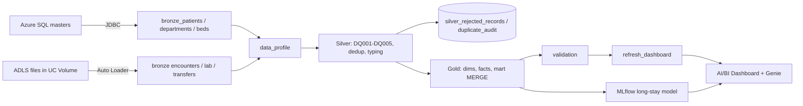
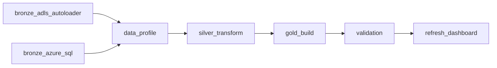
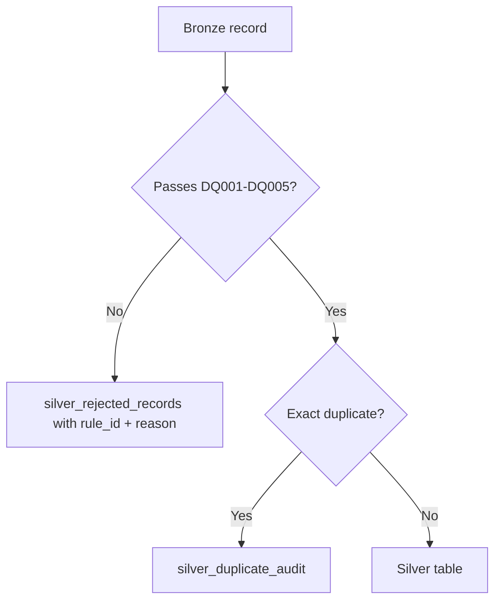
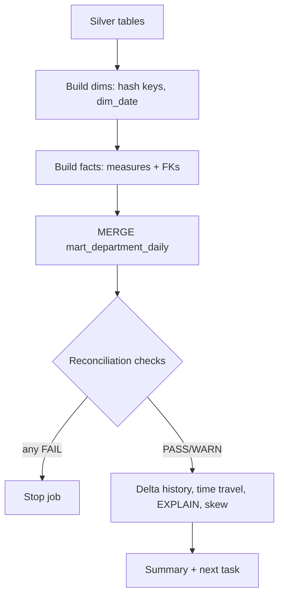
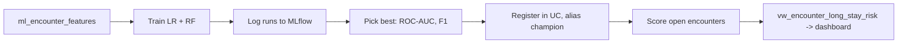

# Capstone 8 – Hospital Patient Journey (Databricks Medallion Project)

> Context file for generating notes, PPT bullets, HLD, LLD and flowcharts.
> Facts marked (verified) were checked against Unity Catalog / job run; others come from notebook code.
> Data is synthetic. No credentials or row-level patient data are included here.

## 1. Problem & goal
* Hospital operations need one trusted view of the patient journey: encounters (admission to discharge), lab tests, bed transfers.
* Goal: ingest from two sources, clean and validate, model a star schema, publish daily department KPIs on a dashboard, and pilot an ML long-stay risk model.

## 2. Platform & tools
* Azure Databricks, Unity Catalog (catalog `capstone_8hospital`), Delta Lake, PySpark + SQL, serverless compute.
* Sources: Azure SQL (JDBC) for masters; ADLS files via UC Volume `/Volumes/capstone_8hospital/bronze_schema/ext_capstone8_vol` (folders `patient_encounters/`, `event_data/`).
* Orchestration: Lakeflow Job `cap8_PIPE` (job id 784129931086509), file-arrival trigger on the volume.
* Consumption: AI/BI dashboard "Hospital Patient Flow & Clinical Operations", Genie, MLflow + UC model registry.
* Git folder `Capstone-8-Hospital-ops` organised by DAY 1–5.

## 3. Job cap8_PIPE (verified from run 495082963739170, 05 Nov 2026, manual, Succeeded, 7m55s)
| # | Task | Notebook | Depends on | Duration |
|---|---|---|---|---|
| 1 | bronze_adls_autoloader | DAY 1/02_bronze_adls_ingestion_healthcare | – | 57s |
| 2 | bronze_azure_sql | DAY 1/01_jdbc_connection | – | 47s |
| 3 | data_profile | DAY 1/03_bronze_profiling | 1, 2 | 31s |
| 4 | silver_transform | DAY 2/04_silver_layer_healthcare | 3 | 2m26s |
| 5 | gold_build | DAY 3/05_gold_layer_healthcare (1) | 4 | 1m25s |
| 6 | validation | DAY 4/06_pipeline_validation_healthcare | 5 | 1m29s |
| 7 | refresh_dashboard | DAY 4/07_monitoring_refresh_healthcare | 6 | 1m03s |

Run metrics: 478 queries, 765,242 rows read, 37,273 rows written; lineage 24 upstream / 23 downstream tables.

## 4. Bronze layer – `bronze_schema` (raw, as-is + audit columns `_source_file`, `_ingested_at`)
| Table | Source | Rows | Cols |
|---|---|---|---|
| bronze_patients | Azure SQL dbo.patient_master (JDBC) | 183 | 10 |
| bronze_departments | Azure SQL dbo.department_master | 192 | 10 |
| bronze_beds | Azure SQL dbo.bed_master | 201 | 10 |
| bronze_patient_encounters | ADLS CSV batches, Auto Loader | 12,376 | 15 |
| bronze_lab_test_events | ADLS event files, Auto Loader | 758 | 13 |
| bronze_bed_transfer_events | ADLS event files, Auto Loader | 392 | 13 |
| profiling_summary | profiling of Bronze (nulls, distincts, ranges) | 116 | 6 |

* Auto Loader = incremental file ingestion with checkpoint (each file processed once); JDBC = full read of master tables.

## 5. Silver layer – `silver_schema` (clean, typed, deduplicated, validated)
* Data quality rules DQ001–DQ005 applied; failures go to `silver_rejected_records` (dataset, business_key, rule_id, reason, raw_record, rejected_at).
* Observed (verified): only DQ003 "Invalid category: triage_priority" fired – 24 encounters with value `UNKNOWN_CODE`.
* DQ001, DQ002, DQ004, DQ005: definitions are in DAY 2/04_silver_layer_healthcare (take from the notebook; they recorded 0 rejections).
* 47 exact duplicate encounters removed, logged in `silver_duplicate_audit`.
* `silver_patient_encounters` = 12,376 − 24 − 47 = 12,305.
* Lab / transfer events whose parent encounter was rejected are kept and reported (not deleted).
* Tables: silver_patients, silver_departments, silver_beds, silver_patient_encounters, silver_lab_test_events, silver_bed_transfer_events, silver_rejected_records, silver_duplicate_audit.

## 6. Gold layer – `gold_schema` (star schema + KPI mart)
| Table | Type | Grain (1 row =) | Key | Rows |
|---|---|---|---|---|
| dim_patient | dim | patient | patient_key = sha2(patient_id,256) | 183 |
| dim_department | dim | department | department_key = xxhash64(department_id) | 192 |
| dim_bed | dim | bed | bed_key = xxhash64(bed_id) | 201 |
| dim_date | dim | calendar day | date_key yyyyMMdd | 183 |
| fact_patient_encounter | fact | encounter | encounter_key; measure length_of_stay_hours | 12,305 |
| fact_lab_test_event | fact | lab test event | lab_event_key; measure lab_turnaround_minutes | 758 |
| fact_bed_transfer_event | fact | bed transfer | transfer_key; measure recording_delay_minutes | 392 |
| mart_department_daily | mart | department per day | date_key + department_key | 5,688 |

Other Gold objects (verified): `test_results`, `perf_benchmark`, view `v_analyst_department_daily_kpi` (Day 4); ML objects (ml_encounter_features, encounter_long_stay_risk, model) are created by the Day 5 notebook – not yet present in gold_schema on 05 Nov 2026 (verified).

Key design points
* Privacy: patient_id never reaches Gold (SHA-256 pseudonymisation; access control still needed).
* Deterministic hash keys – same value every run, no re-keying of facts.
* Facts keep business IDs (encounter_id etc.) for traceability to Silver/Bronze.
* Dims/facts: full overwrite (idempotent). Mart: incremental MERGE on `date_key` and `department_key <=>` (null-safe).
* Incremental test: load 1 (Jul) 2,896 rows → load 2 (Aug) 5,688 → replay Aug 5,688 (no double count).
* KPIs: encounters_admitted, avg_length_of_stay_hours, lab_orders, lab_results, avg_lab_turnaround_minutes, bed_transfers.

Reconciliation & tests (check() → PASS / FAIL / WARN; any FAIL stops the job)
* Row counts: each dim/fact = its Silver table.
* Grain: keys unique in every table.
* Referential integrity: every fact key exists in its dimension (lab/transfer → encounter is WARN only).
* Metric: mart totals = fact totals; per department-day encounters and avg LOS = independent SQL on Silver; overall lab turnaround = independent SQL.
* Sanity: no negative durations.
* Incremental mart = full rebuild (exceptAll both ways = 0).

Delta & performance
* DESCRIBE HISTORY – audit trail of versions/operations.
* Time travel VERSION AS OF first MERGE = load 1 row count (recovery/audit).
* EXPLAIN FORMATTED – check join strategy (broadcast of small dims).
* Skew check – largest department < 2x average encounters.

## 7. Day 4 – validation & monitoring
* 06_pipeline_validation_healthcare: end-to-end validation task in the job.
* 07_monitoring_refresh_healthcare: monitoring + dashboard refresh task.

## 8. Day 5 – consumption, ML, sign-off
* 09_1 dashboard views, 09_2 final regression, 09_3 UAT sign-off, 09_5 Genie runbook sign-off.
* 09_4 ML (MLflow): predict long stay at admission.
  * Label: length_of_stay_hours > 75th percentile (NULL if not discharged).
  * Features (admission-time only, no leakage): encounter_type, triage_priority, admission_source, diagnosis_group, specialty, service_level, capacity_beds, age_band, sex, insurance_type, admission_hour, is_weekend.
  * Models: Logistic Regression vs Random Forest, class_weight balanced, time-based 70/30 split.
  * Selection: highest ROC-AUC, tie-break F1. Experiment `capstone08_long_stay_risk`.
  * Registered in UC as `capstone_8hospital.gold_schema.long_stay_risk_model`, alias `@champion`; scores → `encounter_long_stay_risk`, view `vw_encounter_long_stay_risk`.
  * Limitations: synthetic data, label is a choice, sensitive features need fairness review, scores are ranking not probability, not production-ready.

## 9. Data insights
* Date range 1 Jul – 30 Aug 2026; hospital sites seen include Bengaluru City Medical Centre, Mumbai Central Hospital, Delhi City Hospital, Hyderabad Regional Hospital, Kolkata Medical Centre, Chennai General Hospital.
* Length of stay ≈ 0.08 h (≈5 min) for all encounters; lab turnaround mostly 15 min → synthetic timestamps, KPIs show little variation.
* 6 encounters have null diagnosis_group.
* All DQ issues were in encounters (24 invalid triage + 47 duplicates); masters were clean.

## 10. Diagrams (Mermaid)

End-to-end architecture

Job task graph

Silver DQ flow

Gold build & validation

MLflow lifecycle

## 11. Prompt for Gemini
Using only the attached files, create: (1) study notes per layer, (2) 10–12 PPT slides as bullets, (3) HLD, (4) LLD per table and notebook, (5) render/refine the Mermaid diagrams. Mark anything not in the files as "assumption".
